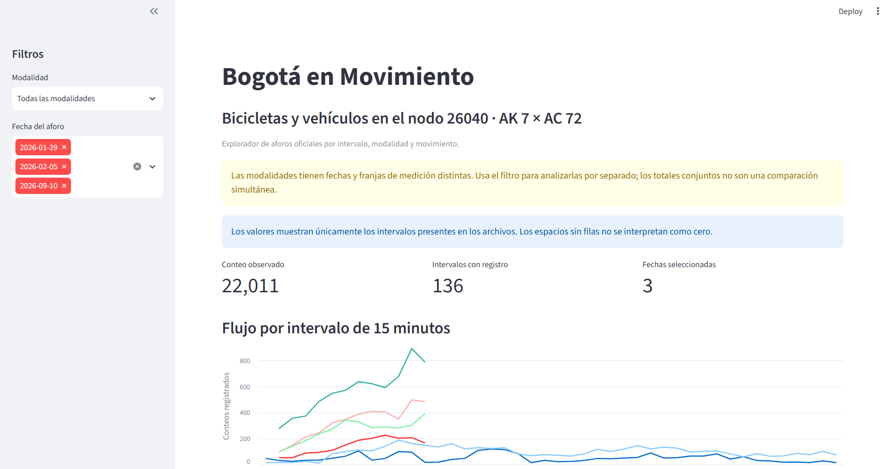

# Bogotá en Movimiento

Proyecto de portafolio para explorar datos abiertos de movilidad urbana de Bogotá, empezando por volúmenes de bicicletas y vehículos.

## Objetivo

Construir un flujo reproducible que descargue o reciba archivos oficiales, los limpie y permita comparar patrones de movilidad con sus fechas y limitaciones claramente documentadas.

## Aplicación en línea

[Ver Bogotá en Movimiento](https://bogota-en-movimiento-ggbjhvvrzhma5ykpbx8xjv.streamlit.app/)



## Cobertura y cómo interpretar los resultados

El snapshot público incluido en este repositorio contiene aforos observados entre **2021-05-06 y 2026-10-15** para **172 nodos**, en las modalidades bicicleta y vehículo. Es una selección de estudios descargados del Observatorio de Movilidad, no una cobertura completa de Bogotá ni una serie continua o en tiempo real.

- La disponibilidad de fechas, horarios y movimientos cambia según el nodo, la modalidad y la ficha de cada estudio. Usa los filtros para revisar cada combinación.
- Los intervalos sin filas son datos ausentes; no representan un conteo de cero.
- Los conteos son observaciones registradas en intervalos. No equivalen a personas únicas, viajes únicos ni al total de movilidad de la ciudad.
- Los ZIP se descargan manualmente del visor; el portal limita cada selección a 20 nodos. Para actualizar el dashboard se agregan los ZIP a `data/incoming/`, se ejecuta el flujo de actualización y se publica el snapshot actualizado en GitHub.
- El mapa incluye los nodos con coordenadas válidas. Localidad, UPZ y Barrio Común se asignan por superposición cartográfica; UPZ es una referencia histórica y Barrio Común no es una validación en terreno.

Consulta [`docs/data_dictionary.md`](docs/data_dictionary.md) para conocer las columnas, las reglas de limpieza y las limitaciones metodológicas.

## Fuente inicial

- Observatorio de Movilidad de Bogotá, mapa de volúmenes vehiculares: <https://observatorio.movilidadbogota.gov.co/mapas/volumenes-vehiculares>
- Los archivos de bicicleta y vehículos pueden corresponder a fechas distintas. El análisis debe mostrar la fecha de cada medición y no presentarlos como si fueran simultáneos.

## Estructura

```text
data/
  raw/          Archivos originales descargados (no se suben a Git)
  incoming/     ZIP descargados del visor (no se suben a Git)
  reference/    Límites oficiales de localidades, UPZ y barrios
  processed/    Datos limpios generados (no se suben a Git)
  public/       Snapshot limpio comprimido que sí usa el dashboard en la nube
  metadata/     Fichas de estudios y catálogo espacial de nodos
src/            Código del proyecto
docs/           Notas de fuentes y decisiones de limpieza
```

## Preparación en Windows (CMD)

Con el entorno virtual activado desde la carpeta del proyecto:

```bat
python -m pip install --upgrade pip
pip install -r requirements.txt
```

Para revisar que Git esté siguiendo los archivos esperados:

```bat
git status
```

## Estado

Dashboard público desplegado en Streamlit Community Cloud. El dataset de la aplicación se mantiene como snapshot versionado en `data/public/aforos_limpios.csv.gz`; las fuentes originales y los datos de trabajo no se publican. Las fuentes y diferencias de cobertura están descritas en `docs/data_dictionary.md`.

## Ejecutar el flujo local

Para incorporar más estudios desde el visor, descarga los ZIP que necesites y guárdalos en `data\incoming`. Luego ejecuta un solo comando:

```bat
python src\refresh_data.py
python -m streamlit run src\dashboard.py
```

`refresh_data.py` ejecuta ingestión de ZIP, limpieza, análisis, catálogo geográfico y snapshot comprimido para la nube. Conserva los ZIP originales, omite copias Excel idénticas y extrae estudios de volumen de bicicletas y vehículos (`VOL`/`VOLB`). La descarga de ZIP desde el visor sigue siendo manual; el script automatiza los pasos posteriores. Para volver a descargar los límites oficiales: `python src\download_geo_reference.py`.

El dashboard permite filtrar por nodo, modalidad y fecha; también muestra un mapa de los nodos elegidos con localidad, UPZ y barrio de referencia asignados por punto-en-polígono a partir de las coordenadas de los Excel. UPZ es una referencia territorial, no un barrio. El catálogo deja visibles sus vías, número de fuentes coincidentes y archivo usado para la coordenada. La cartografía proviene de Catastro Distrital / IDECA; detalles y antigüedad de las capas en `data/reference/README.md`.

En local, el dashboard prefiere `data/processed/aforos_limpios.csv`; en un clon público de GitHub puede cargar `data/public/aforos_limpios.csv.gz`. El comprimido es una copia del dataset observado y se actualiza con `refresh_data.py`; el repositorio no incluye ZIP ni libros Excel de origen.

## PostgreSQL (opcional)

1. Crea una base local llamada `bogota_movilidad` (por ejemplo, con PostgreSQL instalado).
2. Copia `.env.example` a `.env` y cambia la contraseña de `DATABASE_URL`.
3. Ejecuta `python -m pip install -r requirements.txt` para instalar `psycopg`.
4. Corre `python src\refresh_data.py`. Si detecta `DATABASE_URL`, carga/actualiza las tablas `aforos` y `nodos` después de generar los CSV.

La carga de hechos conserva `archivo_fuente` para trazabilidad y no inserta de nuevo claves ya cargadas. Si cambian o se corrigen fuentes con la misma clave pero contenido distinto, se conserva la procedencia; revisa el CSV y la advertencia de múltiples fuentes antes de comparar totales. No compartas ni subas `.env` a Git.

La ingestión desde el visor es manual porque el ZIP se descarga según los nodos seleccionados. Para automatizar las siguientes etapas en Windows, se puede programar `python src\refresh_data.py` en el Programador de tareas después de guardar ZIP nuevos en `data\incoming`; este flujo no inicia sesión ni descarga datos privados por sí mismo.
